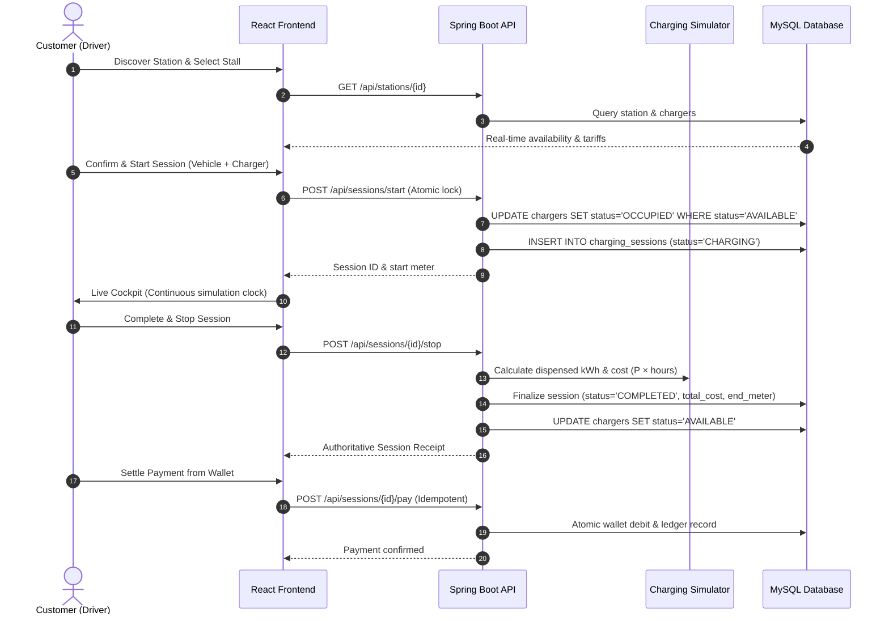
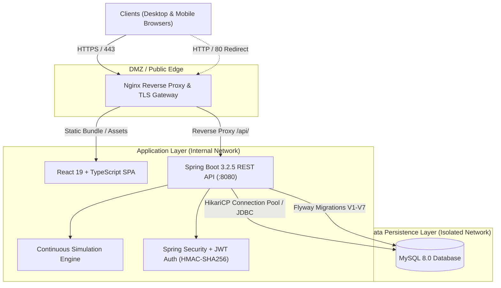
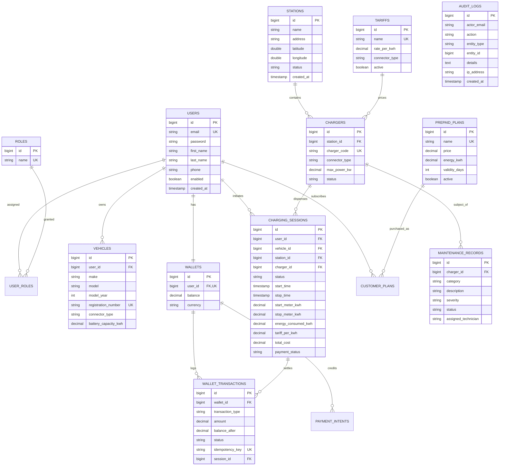

# VoltFlow — Smart EV Charging and Energy Management System

[](https://github.com/voltflow/voltflow/actions)
[](LICENSE)
[](https://spring.io/projects/spring-boot)
[](https://react.dev)
[](https://www.typescriptlang.org)
[](https://www.mysql.com)

VoltFlow is an enterprise-grade full-stack Smart Electric Vehicle (EV) Charging and Energy Management platform. Built for modern EV charging network operators and drivers, it provides station discovery, continuous charging telemetry simulation, automated connector-specific tariff calculation, digital customer wallets with sandbox payments, prepaid energy subscriptions, hardware maintenance workflows, administrator operations, and immutable security audit logging.

---

## 1. Project Overview & Workflows

### 1.1 What VoltFlow Does
VoltFlow orchestrates the lifecycle of electric vehicle charging hubs:
- **For EV Drivers:** Real-time hub discovery, connector compatibility verification, live telemetry cockpits, simulated energy delivery, automated invoicing, and digital wallet payment settlements.
- **For Network Administrators:** Centralized operational cockpit, hardware stall provisioning, dynamic electricity tariff administration, maintenance ticket dispatch, driver refund processing, and financial ledger auditing.

### 1.2 Intended User Roles
| Role | Access Level | Primary Responsibilities |
| :--- | :--- | :--- |
| `PUBLIC` | Anonymous visitors | Browse stations, check connector compatibility, view platform tariffs, register accounts. |
| `ROLE_CUSTOMER` | Authenticated EV drivers | Manage EV fleet in garage, initiate charging sessions, monitor live telemetry, pay invoices, top up wallet. |
| `ROLE_ADMIN` | Station operators & techs | Monitor fleet metrics, deploy chargers, update tariffs, create maintenance tickets, issue refunds. |
| `ROLE_SUPER_ADMIN` | Platform administrators | Full system access, audit trail inspection, user authorization management. |

### 1.3 Customer Charging Workflow


### 1.4 Administrator Operations Workflow
1. **Telemetry & Operations Cockpit:** Live visibility into total registered EV drivers, active hubs, dispenser availability breakdown (Available / Occupied / Maintenance / Offline), and real-time revenue aggregates.
2. **Station & Hardware Dispenser Management:** Provision new fast-charging stations, register dispensers with connector types (CCS2, CHAdeMO, Type 2), configure peak power in kW, and decommission stalls.
3. **Dynamic Tariff Configuration:** Maintain connector-specific pricing per kWh (e.g., `$0.35/kWh` DC Fast, `$0.22/kWh` AC Destination) with validation preventing conflicting active tariffs.
4. **Maintenance & Technician Workflows:** Log hardware faults (cable lock failures, screen outages, power module degradation), assign field technicians, update status (`IN_PROGRESS` → `RESOLVED`), and auto-restore charger availability upon ticket closure.
5. **Ledger & Audit Trail Inspection:** Review immutable financial transactions and view tamper-evident records of administrative actions.

### 1.5 Simulated Telemetry & Sandbox Payment Architecture
> [!NOTE]
> **Engineering Scope & Platform Transparency:**
> - **Continuous Energy Simulation:** Charging sessions calculate consumed energy deterministically using standard electrical physics: $\text{Energy (kWh)} = \text{Power (kW)} \times \text{Duration (hours)}$. No physical charging hardware is connected.
> - **OCPP Protocol Scope:** Physical charger hardware protocols (OCPP 1.6-J / 2.0.1 JSON WebSocket brokers) are not connected; hardware availability and meter registers are managed reliably via transactional database states.
> - **Isolated Sandbox Payments:** All wallet top-ups, card authorizations, and invoice settlements operate in a self-contained simulated sandbox (`SANDBOX_CARD`). No external payment gateway credentials are used and no real financial charges are incurred.

---

## 2. System Architecture



### Technology Stack
- **Frontend:** React 19, TypeScript, Vite, Tailwind CSS, Vitest.
- **Backend:** Java 17, Spring Boot 3.2.5, Spring Security, JWT, Spring Data JPA, Hibernate, Flyway.
- **Database:** MySQL 8.0 (InnoDB, utf8mb4, transactional ACID integrity).
- **Infrastructure:** Docker, Docker Compose, Nginx (TLS termination, HTTP security headers).
- **Testing:** JUnit 5, Mockito, Spring Boot Test, H2 in-memory test database, Vitest.

---

## 3. Database Entity-Relationship Diagram

The database schema is managed via Flyway migrations `V1__init.sql` through `V7__add_performance_indexes.sql`:



---

## 4. UI Screenshot Gallery

| Screen | Description | Reference Artifact |
| :--- | :--- | :--- |
| **Landing Page (Desktop)** | Public introduction, value proposition, live network counter | `docs/screenshots/landing_desktop.png` |
| **Landing Page (Mobile)** | Responsive navigation drawer, touch targets, and responsive hero | `docs/screenshots/landing_mobile.png` |
| **Customer Dashboard** | Driver garage, recent sessions, wallet summary, quick actions | `docs/screenshots/customer_dashboard.png` |
| **Active Charging Cockpit** | Continuous energy accumulator, delivery speed, stop modal | `docs/screenshots/active_charging.png` |
| **Admin Operations Cockpit** | Dispenser breakdown, active sessions, financial totals, navigation | `docs/screenshots/admin_dashboard.png` |
| **Admin Maintenance Management**| Hardware repair tickets, severity filters, technician dispatch | `docs/screenshots/admin_maintenance.png` |
| **Admin Plan Administration** | Prepaid energy subscription package configuration | `docs/screenshots/admin_plans.png` |

---

## 5. Currency & Financial Consistency

VoltFlow standardizes strictly on **USD ($)** across all layers:
- **Database:** Column defaults in `wallets` and `wallet_transactions` are `USD` with `DECIMAL(12, 2)` monetary precision.
- **Tariffs:** Structured as `DECIMAL(10, 4)` to support exact electricity pricing (e.g. `$0.3500 / kWh`).
- **Frontend Utility:** All components import centralized formatters from `frontend/src/utils/currency.ts`:
  - `formatCurrency(val)`: Formats standard values (`$25.00`), zero (`$0.00`), and negative refunds (`-$15.50`).
  - `formatTariffRate(rate)`: Formats rates as `$X.XX / kWh`.
  - `formatEnergy(kwh)`: Formats delivered power as `X.XX kWh`.

---

## 6. Demo Data & Test Isolation

### Demonstration Fixtures
- Flyway migrations `V1`–`V5` seed initial demo stations (e.g., Downtown EV Hub, Mission District Supercharger), standard connector tariffs, and sample maintenance tickets.
- All demo stations use realistic coordinates in the San Francisco Bay Area and include OpenStreetMap direct navigation links.

### Complete Isolation in Automated Tests
- Backend tests (`backend/src/test/resources/application-test.yml`) execute against an in-memory H2 database with `flyway.enabled: false` and `ddl-auto: create-drop`. Tests never write to or read from MySQL.
- The `ProductionSecurityValidator` executes on `@Profile("prod")` and fails fast on default development secrets or wildcard CORS configurations, ensuring development credentials cannot be deployed into production.

---

## 7. Local Development & Quick Start

### Prerequisites
- Docker Engine 24+ and Docker Compose v2+
- (Host builds): Java 17 JDK, Maven 3.9+, Node.js 20+

### Step 1: Environment Setup
```bash
cp .env.example .env
```

### Step 2: Start All Services via Docker
```bash
docker compose up -d --build
```
This boots:
1. `voltflow-db`: MySQL 8.0 on host port `3307` (container port 3306).
2. `voltflow-backend`: Spring Boot 3 API on host port `8080`.
3. `voltflow-frontend`: React application on host port `5173`.

### Step 3: Verify Liveness
```bash
# Check container status
docker compose ps

# Backend Healthcheck
curl http://localhost:8080/actuator/health

# Frontend HTTP Status
curl -I http://localhost:5173/
```

### Accessing the Web Application
- **Frontend Application:** [http://localhost:5173](http://localhost:5173)
- **Backend API Base:** [http://localhost:8080/api](http://localhost:8080/api)
- **Health Endpoint:** [http://localhost:8080/actuator/health](http://localhost:8080/actuator/health)

---

## 8. Verification & Test Suite Execution

### Backend Integration Tests (JUnit 5 + Spring Boot)
```bash
cd backend
mvn test
```
**Expected Result:** 144 tests passing, 0 failures, 0 errors.

### Frontend Unit & Formatting Tests (Vitest)
```bash
cd frontend
npm test
```
**Expected Result:** 22 tests passing across 4 test suites (auth, charging, wallet, currency).

### Frontend Production Build & Typecheck
```bash
cd frontend
npm run lint
npm run build
```
**Expected Result:** 0 ESLint warnings/errors, clean Vite production bundle generated.

### Database Migration Verification
Run the automated migration runner to verify fresh schema initialization against MySQL:
```bash
powershell -ExecutionPolicy Bypass -File .\scripts\test_migration_chain.ps1
```
**Expected Result:** V1 through V7 migrations execute in sequence with exit code 0.

---

## 9. Troubleshooting & Operations

1. **Port 3307 Conflict:**
   - If port 3307 is already bound on your machine, edit `docker-compose.yml` to change `"3307:3306"` to another free port (e.g. `"3308:3306"`).
2. **CORS Rejection:**
   - Verify `CORS_ALLOWED_ORIGINS` in `.env` includes your exact browser origin (e.g. `http://localhost:5173`).
3. **Database Connection Refused:**
   - Wait 10 seconds for `voltflow-db` to complete health initialization before starting local IDE backends.
   - Run `docker logs voltflow-db` to inspect database error logs.

---

## 10. Security & Release Readiness Checklist

- [x] Passwords securely hashed with BCrypt.
- [x] Stateless JWT authentication with expiration.
- [x] Zero public ports on internal database in production profile.
- [x] Fail-fast security validation on production profile.
- [x] Idempotency keys enforced on billing and refund endpoints.
- [x] Sensitive parameters excluded from audit logging.
- [x] Centralized currency and energy formatting.
- [x] Flyway migrations V1–V7 verified on clean database.
- [x] 100% test pass rate across backend (144) and frontend (22).
- [x] Zero credentials, secrets, or certificates committed to Git.
